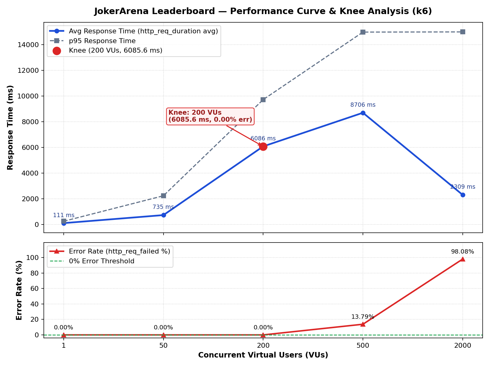

# Laboratorio de Pruebas de Rendimiento — JokerArena (k6)

Repositorio correspondiente al desarrollo del **Laboratorio 6 — Performance** de la asignatura **Arquitectura de Software (2026-II, Universidad Nacional de Colombia)**, ejecutado sobre una porción vertical del proyecto del curso **JokerArena**.

---

## 1. Objetivo del laboratorio

Ejecutar un conjunto de pruebas de rendimiento sobre una funcionalidad real del proyecto del curso utilizando **k6** (Opción 2 de la guía), con el fin de:
1. Desplegar los **4 componentes mínimos** requeridos por la arquitectura (base de datos, microservicio, API Gateway y front-end web).
2. Evaluar el comportamiento del sistema bajo carga concurrente creciente (`1`, `50`, `200`, `500` y `2000` usuarios virtuales).
3. Construir la **curva de rendimiento** (`http_req_duration` promedio vs. concurrencia) e identificar la **rodilla de la curva (*knee*)** por debajo del umbral donde la tasa de error (`http_req_failed`) supera el `0%`.

---

## 2. Cómo se desarrolló

### 2.1 Selección de la funcionalidad bajo prueba
Se seleccionó la funcionalidad **Ranking Global ("Salón de la Fama")** (`GET /api/leaderboard/top?limit=20` a través del API Gateway y `/leaderboard` en el front-end SSR) por las siguientes razones técnicas:
- Atraviesa de extremo a extremo las **4 capas requeridas**: Front-end web → API Gateway → Microservicio → Base de datos.
- Es una ruta pública que **no tiene limitación artificial de tasa (`limit_req`)** en `nginx.conf` (a diferencia de `/api/auth/*`), permitiendo observar la saturación real de la infraestructura bajo alta concurrencia.
- Se omitió Redis intencionalmente en este despliegue aislado para que el microservicio ejecute la consulta Cypher directamente sobre Neo4j en cada petición.

### 2.2 Despliegue aislado de los 4 componentes (`docker-compose.yml`)
El sistema bajo prueba (SUT) se orquestó con Docker Compose (`jokerarena-perf`) aplicando límites de CPU y memoria a cada contenedor para modelar un nodo servidor acotado e independiente del generador de carga (`k6.exe` corriendo nativamente en el host Windows):

| Componente | Contenedor | Tecnología | Puertos / Límites |
|---|---|---|---|
| **Base de datos** | `jokerarena-perf-neo4j` | Neo4j 5.26 Community | `17474`, `17687` · `1.0 CPU`, `1 GB RAM` |
| **Microservicio** | `jokerarena-perf-leaderboard-ms` | Node.js 22 / Fastify | interno `8086` · `0.5 CPU`, `512 MB RAM` |
| **API Gateway** | `jokerarena-perf-gateway` | Nginx 1.27 | `18080:8080` · `0.5 CPU`, `256 MB RAM` |
| **Web Front-end** | `jokerarena-perf-web-ssr` | Next.js 14 SSR | `13000:3000` · `0.5 CPU`, `512 MB RAM` |

### 2.3 Carga inicial de datos y verificación
1. Se implementó [`seed_neo4j.py`](seed_neo4j.py) para poblar Neo4j vía API HTTP transaccional con **30 nodos `Player`** y **120 nodos `Match`** (relaciones `[:PLAYED]`), garantizando consultas reales de agregación y ordenamiento.
2. Se verificó el flujo completo con respuestas HTTP `200` tanto en el API Gateway (`http://localhost:18080/api/leaderboard/top?limit=3`, con `cached: false`) como en el front-end SSR (`http://localhost:13000/leaderboard`).

### 2.4 Diseño y ejecución de las pruebas con `k6`
- Se creó [`k6/performance_test.js`](k6/performance_test.js) siguiendo la estructura de la Opción 2 de la guía (`http.get`, `check` de estado `200` y `sleep(1)`).
- El script [`run_load_tests.ps1`](run_load_tests.ps1) automatizó la ejecución secuencial de:
  1. Niveles fijos de **1**, **50**, **200**, **500** y **2000** VUs durante `30s` cada uno (exportando resúmenes JSON en `results/summary_*vu.json` y logs en `results/k6_*vu.txt`).
  2. El barrido unificado por etapas (`stages`: `1 → 50 → 200 → 500 → 2000 → 0` de `30s` por etapa), exportando `results/summary_stages.json`.
- El script [`analyze_results.py`](analyze_results.py) procesó los resúmenes de `k6`, calculó matemáticamente la rodilla de la curva por debajo del umbral de fallos y generó la gráfica [`results/performance_curve.png`](results/performance_curve.png).

---

## 3. Cómo se cumplieron los objetivos y resultados obtenidos

| VUs concurrentes | Peticiones | Throughput (req/s) | `http_req_duration` (avg) | Mediana | p95 | Máximo | `http_req_failed` |
|---:|---:|---:|---:|---:|---:|---:|---:|
| **1** | 27 | 0.9 | 110.62 ms | 76.92 ms | 254.74 ms | 419.02 ms | **0.00%** |
| **50** | 885 | 28.2 | 735.15 ms | 575.16 ms | 2240.18 ms | 3448.85 ms | **0.00%** |
| **200** | 941 | 26.4 | 6085.56 ms | 5943.37 ms | 9729.93 ms | 12055.86 ms | **0.00%** |
| **500** | 1777 | 45.1 | 8705.91 ms | 9035.56 ms | 14989.71 ms | 15028.67 ms | **13.79%** |
| **2000** | 16530 | 360.3 | 2309.08 ms* | 0.00 ms* | 15003.88 ms | 15163.26 ms | **98.08%** |

*\*Con 2000 VUs, el 98.08% de las peticiones fallan inmediatamente por rechazo/agotamiento de conexiones (`0 ms`) o timeout (`15s`), lo que reduce el promedio global; en las 318 respuestas exitosas (`expected_response:true`), el promedio fue de **3170.70 ms**.*



### Cumplimiento de la conclusión del laboratorio
- **Umbral de error (`http_req_failed > 0%`):** comienza en **500 VUs** (`13.79%`) y alcanza saturación casi total en **2000 VUs** (`98.08%`).
- **Rodilla de la curva (*Knee*):** identificada en **200 VUs** (`avg = 6085.56 ms`, `0.00%` de errores), donde la latencia crece abruptamente respecto a `50` VUs (`735.15 ms`) manteniendo aún `0%` de fallos.
- **Verificación:** la rodilla (**200 VUs**) se encuentra estrictamente por debajo del umbral de errores (**500 VUs** y **2000 VUs**), cumpliendo a cabalidad los objetivos de la práctica.

---

## 4. Estructura del repositorio

```text
.
├── docker-compose.yml              # Despliegue de los 4 componentes (Neo4j, MS, Gateway, Web SSR)
├── .env.example                    # Plantilla de variables de entorno
├── seed_neo4j.py                   # Poblado inicial de datos en Neo4j
├── k6/
│   └── performance_test.js         # Script k6 (niveles fijos y stages hasta 2000 VUs)
├── run_load_tests.ps1              # Orquestador de ejecución de pruebas k6
├── analyze_results.py              # Cálculo de la rodilla y generación de la gráfica
└── results/
    ├── performance_curve.png       # Gráfica de curva de rendimiento y rodilla
    ├── PERFORMANCE_REPORT.md       # Informe técnico detallado de resultados
    ├── analysis_summary.json       # Resumen consolidado de métricas y rodilla
    ├── summary_*vu.json            # Resúmenes JSON exportados por k6
    └── k6_*.txt                    # Salidas completas de consola de k6
```

## 5. Reproducción rápida

> **Requisito:** tener `Prototipo 1` como carpeta hermana (para los contextos de compilación de `leaderboard-stats-ms`, `gateway` y `web-ssr`), Docker Desktop activo y `k6` instalado.

```powershell
copy .env.example .env
docker compose up --build -d --wait
python seed_neo4j.py
powershell -ExecutionPolicy Bypass -File .\run_load_tests.ps1
python analyze_results.py
```
