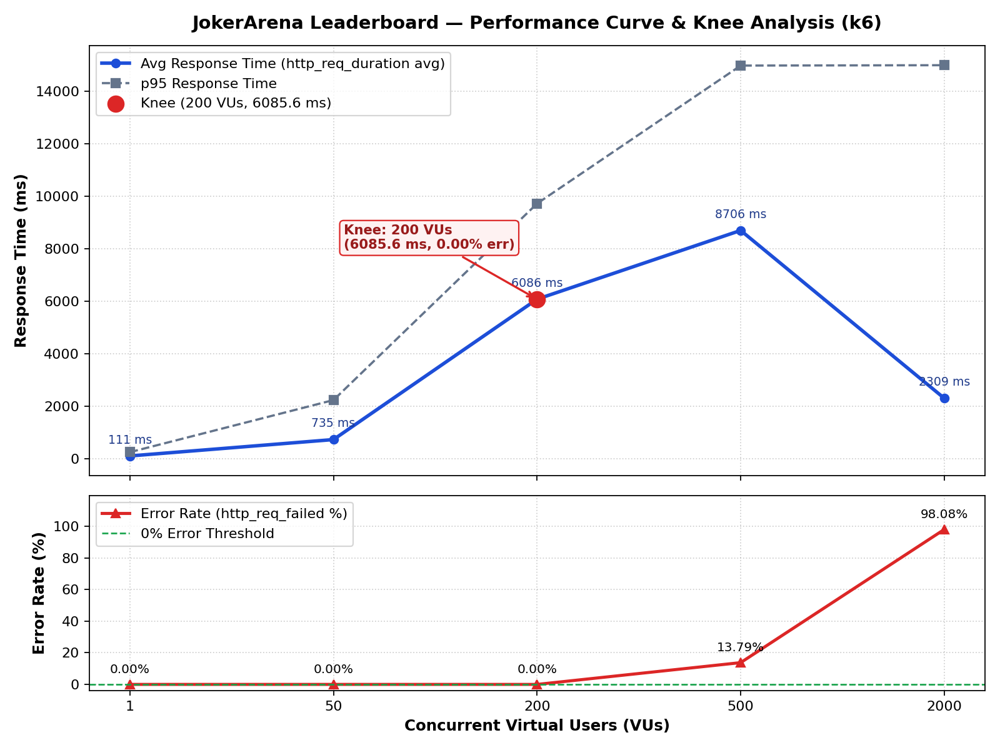

# Performance Test Report — Laboratory 6 (JokerArena Leaderboard)

## 1. System Under Test (4-Component Slice)

Selected feature: **Global Leaderboard ("Salón de la Fama")** (`GET /api/leaderboard/top?limit=20` via API Gateway; rendered in SSR via `/leaderboard`).

| Layer | Component | Technology | Container Limits |
|---|---|---|---|
| **Database** | `jokerarena-perf-neo4j` | Neo4j 5.26 Community | 1.0 CPU, 1 GB RAM |
| **Microservice** | `jokerarena-perf-leaderboard-ms` | Node.js 22 / Fastify | 0.5 CPU, 512 MB RAM |
| **API Gateway** | `jokerarena-perf-gateway` | Nginx 1.27 (`:18080`) | 0.5 CPU, 256 MB RAM |
| **Web Front-end** | `jokerarena-perf-web-ssr` | Next.js 14 SSR (`:13000`) | 0.5 CPU, 512 MB RAM |

Load generator: **`k6.exe` v2.4.0** running natively on the Windows host against `http://localhost:18080/api/leaderboard/top?limit=20` (seeded with 30 `Player` nodes and 120 `Match` nodes in Neo4j; Redis cache disabled so every request executes the Cypher `TOP` graph aggregation).

---

## 2. Load Test Results (`k6`)

### Fixed Load Levels (30s per level)

| Concurrent VUs | Requests | Throughput (req/s) | Avg (`http_req_duration`) | Median | p95 | Max | Error Rate (`http_req_failed`) |
|---:|---:|---:|---:|---:|---:|---:|---:|
| **1** | 27 | 0.9 | 110.62 ms | 76.92 ms | 254.74 ms | 419.02 ms | **0.00%** |
| **50** | 885 | 28.2 | 735.15 ms | 575.16 ms | 2240.18 ms | 3448.85 ms | **0.00%** |
| **200** | 941 | 26.4 | 6085.56 ms | 5943.37 ms | 9729.93 ms | 12055.86 ms | **0.00%** |
| **500** | 1777 | 45.1 | 8705.91 ms | 9035.56 ms | 14989.71 ms | 15028.67 ms | **13.79%** |
| **2000** | 16530 | 360.3 | 2309.08 ms* | 0.00 ms* | 15003.88 ms | 15163.26 ms | **98.08%** |

*\*At 2000 VUs, 98.08% of requests fail immediately (connection/socket exhaustion at `0 ms` or 15s timeout), lowering the overall `http_req_duration` average across all requests; among the 318 successful HTTP 200 responses (`expected_response:true`), the average duration was **3170.70 ms** (max `14879.74 ms`).*

### Unified `stages` Sweep (`1 → 50 → 200 → 500 → 2000 → 0`, 30s per stage)
- Total requests: `8954` (`194.55 req/s`)
- Overall `http_req_duration` avg: `5870.03 ms` (`expected_response:true` avg: `10288.29 ms`)
- Overall `http_req_failed`: `98.57%` (`8826 / 8954` failed once the sweep entered saturation)

---

## 3. Performance Curve & Knee Identification

### Conclusion: Knee of the Performance Curve
- **Error Threshold:** `http_req_failed` first exceeds `0%` at **500 VUs** (`13.79%` errors) and reaches near-total saturation at **2000 VUs** (`98.08%` errors).
- **Identified Knee:** **200 VUs** (`avg = 6085.56 ms`, `error = 0.00%`).
- **Interpretation:** Between `1` and `50` VUs, response time remains well-behaved (`110.62 ms` → `735.15 ms`, `0.00%` errors). At `200` VUs, average latency jumps sharply to `6085.56 ms` while still maintaining `0.00%` failures—marking the inflection point (**knee**) where Neo4j/Fastify queuing saturates. Beyond `200` VUs, at `500` VUs, the system crosses the error threshold (`13.79%` failed requests). Thus, the knee (**200 VUs**) lies strictly below the failure threshold (**500 VUs** and **2000 VUs**), satisfying the laboratory requirement.
